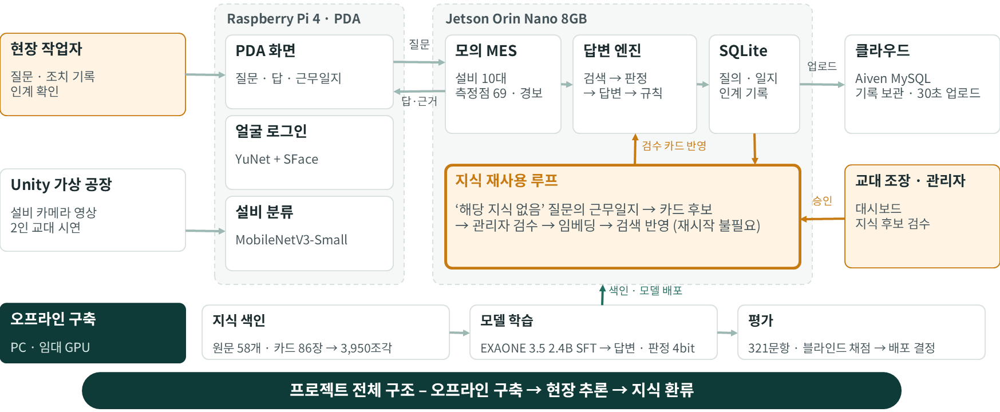
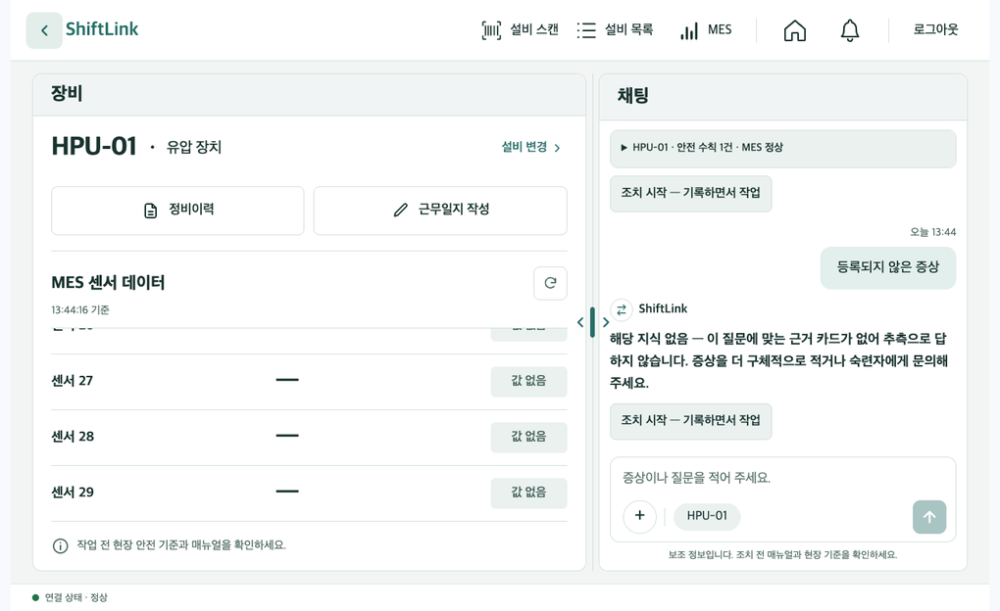
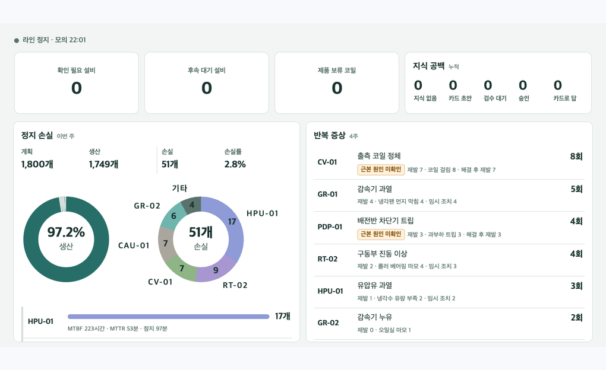
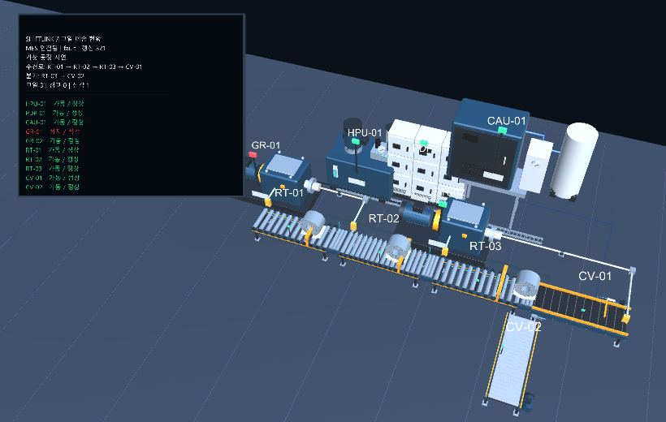
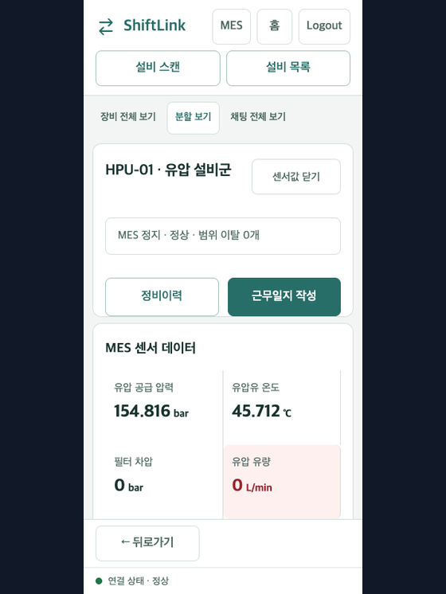
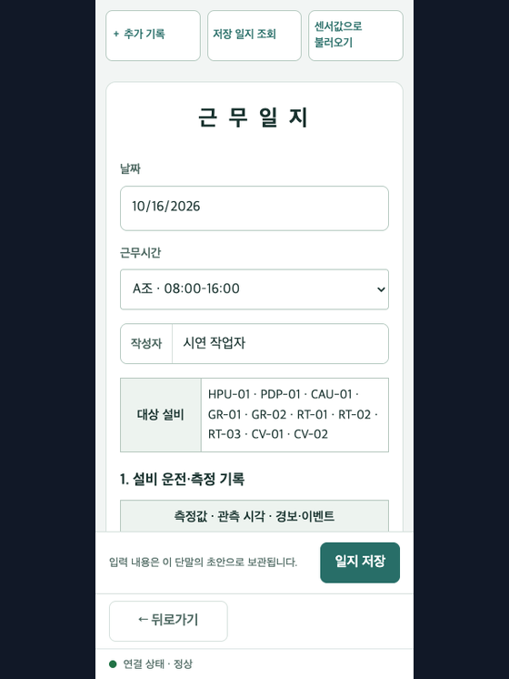
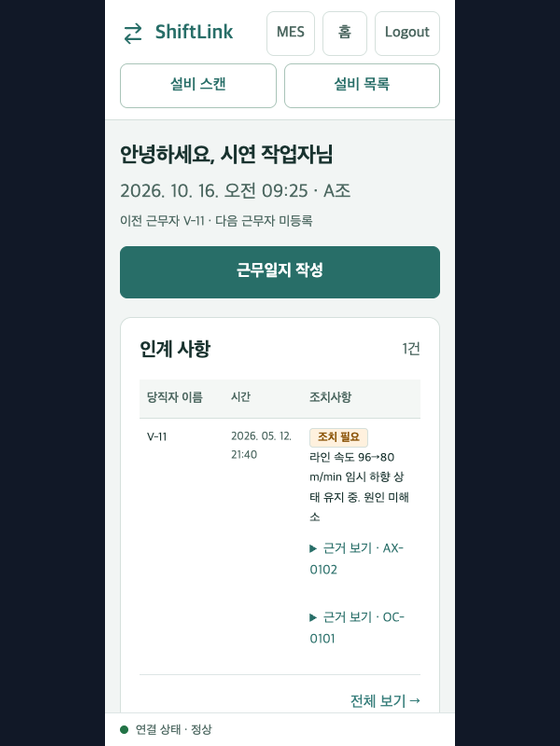
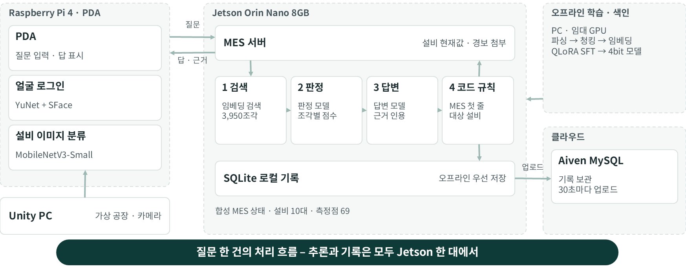
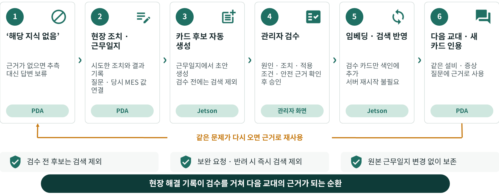

<div align="center">

<h1>ShiftLink</h1>

📦 **제출 자료** : [`docs/result/프로젝트 결과물`](<docs/result/프로젝트 결과물/>)<br>
<sub>최종 발표 자료(PPTX) · 프로젝트 결과보고서 · 원문-RAG 구축 과정 · 모델 발전 보고서 · 운영 온톨로지와 상황 인식 실험 계획</sub>

**현장 지식과 설비 상태를 잇는 온디바이스 AI 에이전트**<br>
*“현장의 질문에, 현장의 데이터로 답하다.”*

[](https://github.com/hyjuy/ShiftLink/actions/workflows/ci.yml)
[](requirements.txt)
[](docs/guides/run-demo.md)
[](#동작-방식)

**[아키텍처](docs/architecture/README.md) · [시연 실행 가이드](docs/guides/run-demo.md) · [문서 목차](docs/README.md)**

[비교](#기존-방식과-비교) · [배경](#왜-만들었나) · [화면](#화면) · [동작 방식](#동작-방식) · [검증 결과](#검증-결과) · [빠른 시작](#빠른-시작) · [하지 않는 것](#shiftlink가-하지-않는-것) · [기여하기](#기여하기) · [팀](#팀)

<code>python -m shiftlink.mes</code>

<br><br>



</div>

<br>

현장 작업자는 PDA에 평소 말로 묻습니다.

- *“펌프 소리가 커지고 탱크에 우유빛 거품이 보여. 뭐부터 봐야 해?”*<br>
  → 첫 줄에 지금 상태 `현재 MES(HPU-01): 유압 공급 압력 116 bar 낮음 (기준 145–165)`를 놓고, 지식 카드 `K-1004`를 근거로 에어레이션을 의심해 흡입관 밀봉 · 축 씰 · 리턴 라인 위치를 확인하라고 답합니다.
- *“예비 필터는 어디에 보관돼 있어?”*<br>
  → 근거 자료에 없는 내용이라 위치를 추측하지 않고, 정비 담당 확인이 필요하다고 답합니다.
- *“압력 표시가 요동칠 때 어떤 순서로 점검하나요?”*<br>
  → 처음에는 근거가 없어 답하지 않습니다. 작업자가 조치와 결과를 근무일지에 남기고 관리자가 검수하면, 같은 질문에 그 기록으로 만든 카드 `K-7001`을 근거로 답합니다.

질문부터 답변 · 기록까지 Jetson Orin Nano 8GB 한 대에서 외부 API 없이 처리합니다.

---

## 기존 방식과 비교

| | 매뉴얼 검색 · 구두 인계 | 범용 클라우드 챗봇 | ShiftLink |
|---|---|---|---|
| 지식을 찾는 방법 | 대부분 영문인 매뉴얼 58개 · 2,459쪽을 직접 찾음 | 질문하면 바로 답함 | PDA로 질문하면 카드 · 매뉴얼 쪽수까지 인용해 답함 |
| 설비의 현재 상태 | MES 화면을 따로 확인 | 연동하지 않으면 모름 | 기준 범위를 벗어난 값과 경보를 답변 첫 줄에 표시 |
| 근거가 없을 때 | 아는 사람을 찾아 물음 | 그럴듯한 답을 만들 수 있음 | ‘해당 지식 없음’으로 답변 보류 |
| 네트워크 | 필요 없음 | 외부망 필요 | 외부망 없이 장비 한 대에서 동작, 클라우드는 기록 보관용 |
| 새로 생긴 노하우 | 개인의 기억에 남음 | 남지 않음 | 근무일지 → 관리자 검수 → 지식 카드로 게시 |

한계도 분명합니다. 응답 시간 p95가 10.5초로 목표(10초)를 넘고, 블라인드 테스트셋에서 올바르게 대응한 비율은 48%입니다. 블라인드 테스트의 오답 30건 중 17건은 검색 단계에서 근거를 찾지 못한 경우입니다. 설비 · MES 데이터는 Unity 가상 공장과 모의 MES로 만든 합성 데이터라서, 실제 설비에서는 아직 검증하지 않았습니다.

---

## 왜 만들었나

숙련자가 떠나면 판단 기준과 예외 대응도 함께 사라집니다. 이런 지식은 개인의 기억과 구두 인계에만 남고 기록으로 쌓이지 않습니다([전자신문, 2026-05-28](https://www.etnews.com/20260528000466)). ShiftLink는 기록되지 않던 지식을 다섯 유형으로 나누고, 근거와 적용 조건이 붙은 지식 카드로 만듭니다.

| 유형 | 예 |
|---|---|
| T1 감각 기반 이상 판단 | 소리 · 냄새 · 거품으로 이상 감지 |
| T2 조건부 요령 | 온도 · 부하에 따라 다른 조치 |
| T3 트러블슈팅 순서 | 점검 우선순위와 확인 순서 |
| T4 인수인계 맥락 | 앞 교대의 미완료 작업과 사유 |
| T5 안전 금기 | 절대 금지 조작과 그 이유 |

신입 작업자가 막히는 곳은 세 군데입니다. 수십 개 MES 값 가운데 지금 문제인 값을 찾기 어렵고(상태), 필요한 지식은 매뉴얼 2,459쪽에 흩어져 있으며(지식), ‘필터 점검 미해결’ 같은 인계 메모는 뜻을 알기 어렵습니다(인계). 게다가 외부망 없이 동작해야 하고, 쓸 수 있는 장비는 Jetson Orin Nano 8GB 한 대입니다. 메모리 7.6GB를 답변 모델 · 판정 모델 · 임베딩 · MES가 나눠 씁니다.

> *근거가 없으면 답하지 않습니다.* 현장의 잘못된 지시는 사고로 이어집니다. 모든 답변에 근거를 인용하고, 근거가 약하면 ‘해당 지식 없음’으로 답변을 보류합니다. 답변 보류도 안전 기능입니다.

---

## 화면

<table>
<tr>
  <td align="center" width="33%"><br><b>PDA 질의</b><br><sub>근거가 없으면 ‘해당 지식 없음’</sub></td>
  <td align="center" width="33%"><br><b>MES 대시보드</b><br><sub>정지 손실 · 반복 증상 · 지식 공백 집계</sub></td>
  <td align="center" width="33%"><br><b>Unity 가상 공장</b><br><sub>가상 냉연 라인 · 설비 10대 6종</sub></td>
</tr>
<tr>
  <td align="center"><br><b>설비 확인</b><br><sub>설비별 MES 현재값 · 범위 이탈</sub></td>
  <td align="center"><br><b>근무일지</b><br><sub>조치와 결과를 당시 MES 값과 함께 기록</sub></td>
  <td align="center"><br><b>교대 인계</b><br><sub>이전 교대의 미해결 사항과 근거</sub></td>
</tr>
</table>

가상 설비는 HPU · PDP · CAU · GR · RT · CV 6종 10대입니다. MES 측정점 69개 · 신호 48종과 설비 분류용 이미지 8,951장(학습 7,178 · 검증 893 · 시험 880)을 만들었습니다. 현장 데이터 수집은 공정에 주는 영향이 커서, 가상 공장과 모의 MES로 기능을 먼저 검증했습니다.

---

## 동작 방식

| 장비 | 하는 일 | 관련 코드 |
|---|---|---|
| Jetson Orin Nano 8GB | 모의 MES 서버, 지식 검색 · 판정 · 답변, 기록 저장 · 업로드 | `shiftlink/mes/`, `shiftlink/rag2/`, `shiftlink/edge/` |
| 라즈베리파이 4 (PDA) | 작업자 화면, Jetson API 프록시, 얼굴 확인 · 설비 분류, 설비 이상징후 통계 분석(참고 정보) | `shiftlink/pda/`, `shiftlink/face/`, `shiftlink/vision/`, `scripts/mes_causal_pda_service.py` |
| Unity PC | 공장 시뮬레이션과 작업자 시점 영상 | `unity/ShiftLinkFactory/` |

검색 색인과 모델은 PC · GPU에서 미리 만들고 Jetson은 완성본만 읽습니다. 외부 네트워크는 기록을 클라우드 DB(Aiven MySQL)에 올릴 때만 씁니다. 모듈별 그림 11장은 [아키텍처 문서](docs/architecture/README.md)에 있습니다.

### 질문 한 건의 처리

<div align="center">

</div>

1. **검색**: 원문 58개(2,459쪽)를 700토큰 단위로 나눈 3,824조각에 지식 카드 86장과 인계 기록 40조각을 더한 3,950조각에서, 설비 필터와 코사인 유사도로 최대 8조각을 찾습니다. 임베딩은 embeddinggemma 300M(768차원)입니다.
2. **판정**: SFT 판정 모델이 조각마다 관련 확률 P를 매깁니다. P < 0.3이면 버리고, P ≥ 0.9이면 답을 확정하며, 그 사이는 답변 모델이 판단합니다.
3. **답변**: 답변 모델이 남은 근거만으로 답하고 카드 ID · 매뉴얼 쪽수를 인용합니다.
4. **코드 규칙**: 모델이 반복해서 틀리던 출력은 코드가 고정합니다.

검색 단계에서는 관련 설비 · 카드의 관계로 검색 후보를 보완합니다(`SHIFTLINK_KNOWLEDGE_GRAPH` 기본 `1`, `0`으로 끔). 자세한 조건은 [관계 검색 계약](docs/design/knowledge-graph-runtime.md)을 따릅니다.

| 이럴 때 | ShiftLink는 |
|---|---|
| 근거가 있는 증상 질문 | 판정을 통과한 근거로만 답하고 카드 ID · 매뉴얼 쪽수를 인용합니다 |
| 기준 범위를 벗어난 MES 값 | 현재값과 기준 범위를 코드가 답변 첫 줄에 씁니다 |
| 근거가 약한 질문 | ‘해당 지식 없음’으로 답하고 확인 경로를 안내합니다 |
| Pi 이상징후 분석이 있을 때 | 실행 · 설비 · 시각 검사를 통과한 분석만 참고 문맥으로 덧붙입니다. 인용 · 센서값 · 지식 카드를 대신하지 않으며, 검사에 실패하면 쓰지 않습니다 |
| 지난 근무일지를 묻는 질문 | 과거 기록 조회를 따로 분류해 일지 원문을 찾아 답합니다. 현재 · 미래 요청은 기존 판단 경로로 보내고, Pi 분석은 섞지 않습니다 |
| 인용 근거에 없는 숫자가 답변에 들어감 | 답변을 보류하고 검수 대기로 넘깁니다 |
| 값이 없는 센서 | ‘정상’ 대신 ‘관측값 없음’으로 씁니다 |
| 질문 대상이 아닌 설비의 기록이 섞임 | 그 문장을 지웁니다 |
| 네트워크 단절 | SQLite에 먼저 저장하고 복구되면 자동으로 보냅니다(18분 38초 단절 시험에서 손실 0 · 중복 0) |

### 지식 재사용 루프

<div align="center">

</div>

‘해당 지식 없음’에서 시작한 현장 조치가 관리자 검수를 거쳐 다음 교대의 근거가 됩니다.

1. 근거가 없는 질문에는 ‘해당 지식 없음’으로 답합니다.
2. 작업자가 실제로 한 조치와 결과를 근무일지에 남깁니다. 질문에서 시작한 일지는 원래 질문을 함께 보존합니다.
3. 근무일지에서 지식 카드 후보를 만듭니다. 후보 단계에서는 검색에 쓰지 않습니다.
4. 관리자가 MES 검수 화면에서 검토 승인과 검수 통과를 처리합니다.
5. 임베딩이 끝나면 검색에 반영됩니다. 서버를 다시 띄울 필요가 없습니다.
6. 같은 설비에서 다시 물으면 새 카드가 검색 후보가 되고, 판정을 통과하면 근거로 쓰입니다.

2026-10-23 실제 Jetson · 라즈베리파이의 격리 환경에서 ‘근거 없음 → 근무일지 → 검수 → 게시 → `K-7001` 인용 답변’ 흐름을 확인했습니다. 운영 DB에서 한 검증은 아닙니다. [검증 기록](docs/testing/knowledge-gap-loop-20261023.md) · [사용 방법](docs/guides/knowledge-publication.md)

### 모델 구성 (한 문단)

답변 모델과 판정 모델은 EXAONE 3.5 2.4B를 SFT한 뒤 4bit(GGUF Q4_K_M)로 양자화해 씁니다. Jetson 20문항 비교에서 EXAONE 3.5 2.4B가 인용 적중 13개로 Qwen2.5-3B(9개)를 앞섰고, 123문항 검색 비교에서 embeddinggemma가 정답 근거 86개를 찾아 bge-m3(77개)를 앞섰습니다. 프롬프트 개선 4종으로는 모델이 MES 현재값을 제대로 읽지 못해, MES 입력 블록을 넣은 데이터로 다시 SFT했습니다. 라즈베리파이 4는 MobileNetV3-Small로 설비를 분류하고(시험 정확도 99.4%, 875/880, 추론 41~63ms), YuNet + SFace로 작업자 얼굴을 확인합니다(임계값 0.363, 5프레임 중 3프레임 통과).

---

## 검증 결과

Jetson에서 같은 321문항(블라인드 테스트 60 · 개발 201 · MES 상황 60)으로 구성을 비교했습니다. 블라인드 테스트셋은 개발 · 튜닝에 쓰지 않았고, 통과 기준은 측정 전에 등록했습니다. 요구사항 9개 중 7개를 충족했습니다.

| ID | 요구사항 | 결과 | 판정 |
|---|---|---|---|
| R1 | 답변마다 근거 인용, 수치 날조 금지 | 근거 밖 숫자 0~1건 · 답변 충실도(RAGAS) 0.76 → 0.86 | 충족 |
| R2 | 답 없는 질문 거절 | 홀드아웃 7/8 · 추가 테스트 17/19 거절 | 충족 |
| R3 | 중대 안전 오류 0건 | 추적 대상 4유형 모두 0건 | 충족 |
| R4 | 응답 p95 10초 이하 | 최종 구성 10.5초 | **미충족** |
| R5 | 여유 메모리 1.0GiB 이상 | 최저 1,035MiB · 메모리 부족 종료 0건 | 충족 |
| R6 | 카드 밖 질문 대응 | 홀드아웃 답변 25/35 (초기 구성 6/35) | 충족 |
| R7 | 현재 상태 반영, 모순 0건 | 현재값 표시 42/42 · 경보 구분 7/8 · 모순 0건 | 충족 |
| R8 | 지식 질문 정확도 유지 | 개발셋 60% (MES 전용 경로 44%에서 회복) | 충족 |
| R9 | 블라인드 테스트 1회 측정 | 블라인드 테스트셋 올바른 대응 48% | **과제** |

현재값 표시 42/42는 화면 표시 기준이며, 모델 답변 자체가 현재값을 반영한 것은 30/42입니다. 안전 오류 0건은 추적한 4유형에 대한 결과로, 현장 안전성 전체를 보장하는 수치가 아닙니다.

<details>
<summary><b>구성별 비교</b> (Jetson · 같은 321문항)</summary>

| 지표 | 비교 기준 | 근거 판정 · 답변 | MES 반영 · 규칙 보완 (최종) |
|---|---|---|---|
| 블라인드 테스트 내용 정답 | 37% | 53% | 58% |
| 블라인드 테스트 올바른 대응 | 45% | 50% | 48% |
| 개발셋 올바른 대응 | 61% | 63% | 60% |
| 현재 MES 값 표시 (/42) | 6 | 0 | 42 |
| 경보 구분 (/8) | 0 | 2 | 7 |
| 현재 상태와 모순 (건) | 1 | 12 | 0 |
| 응답 시간 p95 (초) | 7.4 | 9.0 | 10.5 |
| 여유 메모리 (MiB) | 1,299 | 1,163 | 1,035 |

올바른 대응은 근거를 인용한 답변과 근거 없는 질문의 거절을 합친 비율입니다. 최종 구성의 내용 정답은 답변이 같은 직전 구성의 채점값입니다.

</details>

---

## 빠른 시작

장비 없이 모의 MES 대시보드를 확인할 수 있습니다. Python **3.10은 CI 기준 버전**이며, 아래 명령은 저장소 루트에서 실행합니다.

```bash
git clone https://github.com/hyjuy/ShiftLink.git
cd ShiftLink
python -m venv .venv
```

가상환경을 활성화합니다.

```bash
# macOS / Linux
source .venv/bin/activate
```

```powershell
# Windows PowerShell
.venv\Scripts\Activate.ps1
```

의존성을 설치한 뒤 서버를 시작합니다.

```bash
python -m pip install -r requirements.txt
python -m shiftlink.mes
```

- 브라우저에서 [모의 MES 대시보드](http://127.0.0.1:8000/)에 접속합니다. 시작 → 이상상황 선택 → 복구 진행 순서로 확인할 수 있습니다.
- 기본 DB는 `mes_data/mock-mes.sqlite3`에 생성되며 Git에서 제외됩니다. 재시작해도 기존 기록을 보존합니다. 같은 DB를 여러 서버에서 동시에 운전하지 않습니다.
- 포트나 DB 경로를 바꾸려면 `python -m shiftlink.mes --port 8001 --db mes_data/local-demo.sqlite3`을 사용합니다. 종료는 터미널에서 `Ctrl+C`를 누릅니다.
- 센서 값과 성능 경고를 다양하게 만들려면 `--random-faults`, 수리 전까지 유지되는 점진 고장은 `--progressive-faults`(화면의 랜덤 모드 버튼으로 켬)를 붙입니다. 둘 다 합성 시연용이며 실제 설비 데이터가 아닙니다.

<details>
<summary><b>모델을 쓰는 질의</b> (Ollama와 SFT 모델 필요)</summary>

기본 질의 모드는 `hybrid`이며 Ollama와 SFT 판정·답변 모델을 사용합니다. 모델이 준비되지 않으면 경고가 표시되고 질의는 503으로 응답할 수 있습니다. 모델 등록은 [SFT 모델 가이드](docs/guides/sft-judge-model.md)를 참고하세요.

10/16 시연 채택 모드인 `s30h`는 매뉴얼·카드 청크 검색을 사용합니다. `SHIFTLINK_ANSWER_MODE=s30h` 설정 외에도 검색 인덱스와 임베딩·판정·답변 모델이 필요합니다. 인덱스와 모델 파일은 Git에 포함되지 않으므로 [S30h 배포 안내](deploy/s30h.md)에 따라 별도로 준비합니다. 얼굴 인식·설비 분류 의존성과 장비 설치는 [시연 실행 가이드](docs/guides/run-demo.md)를 따릅니다.

10/22 Jetson에 배포한 최종 구성(MES 반영 답변 모델과 코드 규칙)의 확인 기록은 [배포 결과](docs/testing/jetson-main-deployment-result-20261022.md)에 있습니다.

</details>

---

## 문서와 실행 가이드

| 목적 | 문서 |
|---|---|
| 제출 자료 5종 (발표 자료 · 결과보고서 등) | [`docs/result/프로젝트 결과물`](<docs/result/프로젝트 결과물/>) |
| 시스템 그림 11장 | [아키텍처 문서](docs/architecture/README.md) |
| 문서 전체 탐색 | [문서 목차](docs/README.md) |
| 기능별 호출 경로 · 코드 근거 | [기능 지도](docs/design/feature-map.md) |
| Pi 분석을 질의에 참고하는 방법 | [Pi 분석 질의 문맥](docs/guides/pi-analysis-query-context.md) |
| 장비 3대 설치·시작·확인·종료 | [시연 실행 가이드](docs/guides/run-demo.md) |
| 로컬 MES 운전·기록 재생 | [모의 MES 사용법](docs/guides/mock-mes-usage.md) |
| 설비 추가·교체·제거 | [구성 관리 가이드](docs/guides/mock-mes-configuration-guide.md) |
| 이상상황 조치·복귀 | [복구 가이드](docs/guides/mock-mes-recovery.md) |
| Unity 영상과 PDA 연결 | [카메라 스트림 가이드](docs/guides/unity-pda-camera-stream.md) |
| 근무일지 지식 후보 검수·검색 반영 | [지식 게시 가이드](docs/guides/knowledge-publication.md) |
| 데이터 출처·분할·관리 기준 | [데이터 안내](docs/data/README.md) |
| 검증 방법과 과거 결과 | [검증 문서 목차](docs/testing/README.md) |

장비별 주소·모델·설치 경로는 시연 가이드에서 확인합니다. 해당 가이드의 10/8 질의 구성과 이후 S30h 채택 설정은 시점이 다르므로, S30h 구성에는 배포 안내를 함께 확인하세요. 과거 실험 결과는 해당 시점의 기록이며 현재 코드의 재검증 결과와 구분합니다.

## 저장소 구조

```text
shiftlink/
  agent/          질의 라우팅·스키마·고정 파이프라인
  rag/            카드 적재·검색·추출·임베딩
  rag2/           청크 검색과 S30h 답변 엔진
  mes/            모의 MES·API·웹 화면·작업 기록·지식 게시
  pda/            PDA 화면 서버와 Jetson API 프록시
  edge/           Ollama 추론 연동
  face/           얼굴 등록·확인
  vision/         설비 영상 수집·학습·분류
  data/           합성 데이터·시나리오·카드 검증
deploy/           장비 서비스 설치와 배포 안내
docs/             설계·데이터·실행 가이드·검증 기록·발표 자료
eval/             평가 하니스·질문 세트·채점
tests/            Python·JavaScript 회귀 테스트
scripts/          실행·점검·연구 도구
unity/            공장 시뮬레이션
```

---

## ShiftLink가 하지 않는 것

- **설비 제어와 공식 MES 변경**: PLC나 설비를 직접 제어하지 않고 공식 MES 상태를 바꾸지 않습니다. 기존 시스템과 분리된 읽기 전용 보조 도구입니다.
- **안전 · 품질 최종 판정**: 대신하지 않습니다. 코드 규칙은 추적한 오류 유형만 막습니다.
- **실제 설비 기준의 판단**: 모의 MES의 수치 · 고장 · 조치는 합성 시연용입니다. 실제 설비의 운전 · 정비 절차나 현장 안전성을 검증한 결과를 의미하지 않습니다.

근거가 없으면 답하지 않는 것이 설계 원칙입니다. 답을 받지 못했다면 정비 담당이나 숙련자에게 확인하세요.

---

## 기여하기

브랜치와 PR 규칙은 [`docs/collaboration/branching.md`](docs/collaboration/branching.md)를 따릅니다.

### PR 올리기 전 확인

기본 의존성으로 카드 통합과 오프라인 검색 점수를 먼저 확인합니다. 이 검사는 Ollama나 실장비를 사용하지 않습니다.

```bash
python -m pytest -q tests/test_kb_cards.py tests/test_eval_qa_score.py
python docs/data/knowledge_cards/kb/build_kb.py
git diff --exit-code -- docs/data/knowledge_cards/kb/kb_cards.json
python eval/qa/route_score.py
```

[현재 CI](.github/workflows/ci.yml)는 `dev_route_acc`가 **21/30 미만**, `sanity_route_acc`가 **28/30 미만**이면 실패합니다. `route_score.py`는 점수를 출력하며, 임계값 판정은 CI에서 수행합니다. 이 점수는 검색 라우팅 지표이며 최종 생성 답변의 정확도를 뜻하지 않습니다.

전체 Python 회귀 테스트는 `python -m pytest -q`로 실행합니다. 전체 CI에는 기본 의존성 외에 비전·MES 연구용 패키지와 Node.js 테스트가 포함됩니다. 추가 의존성과 실행 명령은 CI 설정을 기준으로 준비하세요. 지식 게시의 브라우저 검증에는 Playwright가 필요하며 [별도 검증 절차](docs/guides/knowledge-publication.md#검증-명령)를 따릅니다.

### 지식 카드

통합 목록 `docs/data/knowledge_cards/kb/kb_cards.json`은 **86장**입니다. 배치 A 30, T4 12(기존 11 + #148 인계 완료 K-1401, 배치 `20261001-handover-completion`), C 19, D 25(1~3차 21장 + 10/1 4차 K-1322~1324 + 5차 K-1325)입니다.

이 숫자는 정적 KB 기준이며, 근무일지에서 검수 후 DB에 게시한 지식은 별도로 관리합니다. 정적 통합 JSON은 직접 수정하지 않고 각 배치의 원본 카드를 수정한 뒤 `build_kb.py`로 재생성합니다. 검색 대상 기준은 `accepted / L1 / kb`입니다.

블라인드 2차 `eval/qa/20261001-blind2/qa_blind2.json`은 답 있음 6/25입니다. `python eval/qa/route_score.py`의 `blind2_route_acc`는 이 셋의 보고 전용이라, 점수를 보고 검색을 맞추지 않습니다.

---

## 팀

2026 온디바이스 AI 프로젝트 · 팀 ShiftLink

| 이름 | 역할 | 맡은 일 | 주요 디렉토리 |
|---|---|---|---|
| 유현준 | 팀장 · 시스템 | 스키마 · 에이전트 구조, 모의 MES · Unity 가상 공장 | `shiftlink/agent/`, `shiftlink/mes/`, `unity/` |
| 최재영 | AI 개발 | RAG 검색 · 답변 엔진, 모델 학습 · 평가 체계 | `shiftlink/rag/`, `shiftlink/rag2/`, `shiftlink/data/` |
| 허재원 | 임베디드 | Jetson 실행 · 추론 · 저장, PDA 화면 · 근무일지 | `shiftlink/edge/`, `shiftlink/mes/` |
| 전혜민 | PM · QA | 일정 · 요구사항, 품질 검수 · 평가 시나리오 | `eval/` |

모의 MES(`shiftlink/mes/`, 실행 DB `mes_data/`)는 유현준 · 허재원이 함께 맡았습니다.

<br>

<div align="center">

*떠나는 노하우는 남는 지식으로, 오늘의 조치는 다음 교대의 근거로.*

</div>
