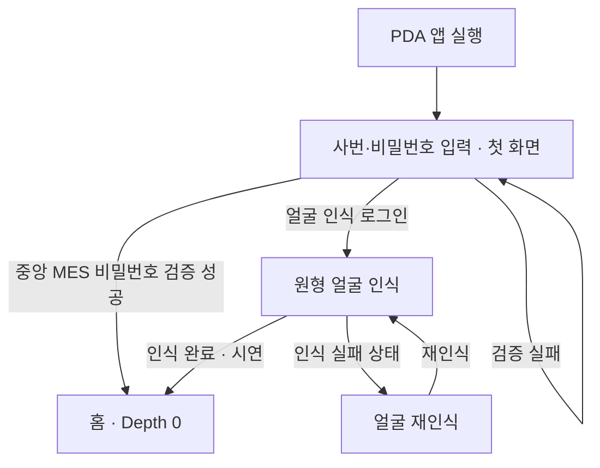
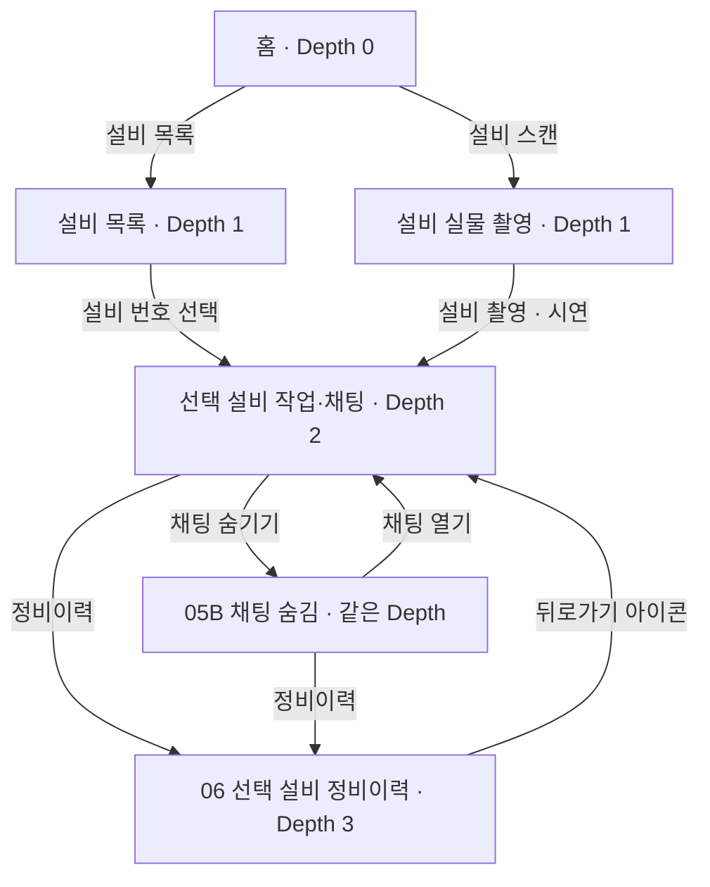
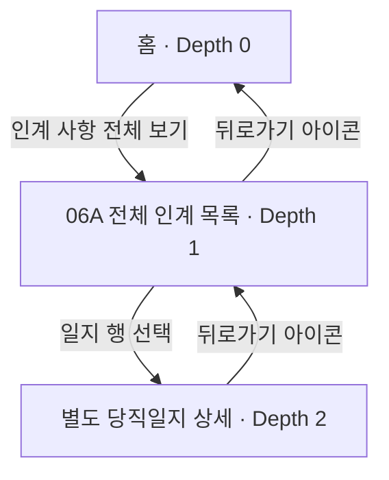
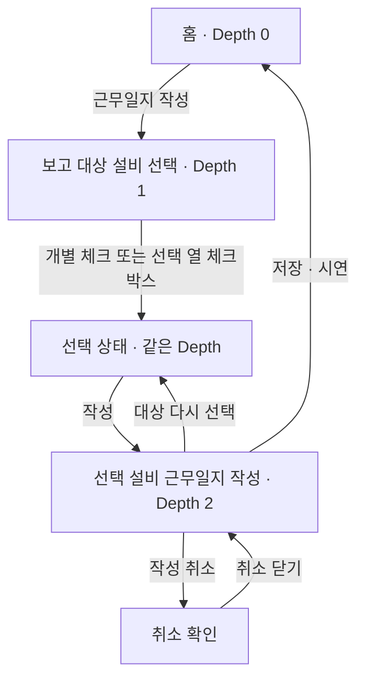

> 2026-10-15 추가 결정: 첫 화면은 계정 로그인 입력 화면으로 직접 진입. 기존 랜딩은 사용 흐름에서 제외하며, 얼굴 인식 대체 경로를 유지한다. PDA에는 계정 등록을 표시하지 않는다. MES 관리자 로그인 후 작업자 계정을 등록하며, PDA 로그인은 중앙 MES에서 비밀번호를 검증한다.

# PDA 화면 구조도 · UI/UX 2차 수정

- 기준일: 2026-10-15 · 이동식 PDA 1280×800 가로, 평소 터치·근무일지 작성 시 외장 키보드.
- 디자인: [Figma · 02. 2차 시안](https://www.figma.com/design/HLbtdMZslgFPZZ9P0EJh76?node-id=115-300)
- 변경 기준: [2차 시안 코멘트](figma-v2-comments-20261015.md).
- **상태 구분:** `확인`은 앞서 시각/클릭 검토한 디자인 프로토타입, `계획`은 2차 코멘트 반영 대상, `미검증`은 실제 연결 확인 전이다. 코드 동시 반영은 아직 미완료이며 실제 인증·저장 완료를 뜻하지 않는다.

## 1. 전체 경로

홈을 Depth 0으로 둔다. Depth는 해당 출발점에서 앞으로 이동하는 단계이며, 뒤로가기·취소·화면 내부 상태 전환은 새로운 Depth로 세지 않는다. 로그인은 홈 진입 전 단계다.

| Depth | 출발 화면 → 누르는 버튼 → 도착 화면 | 상태 |
|---|---|---|
| 진입 전 | 앱 실행 → 사번·비밀번호 입력 화면 | 중앙 MES 계정 인증 · PDA 공개 등록 없음 |
| 진입 전 | 사번·비밀번호 입력 화면 → 얼굴 인식 로그인 → 원형 얼굴 인식 | 원형 디자인 확인 · 2차 배치 변경 계획 |
| 0 | 로그인 화면 → 로그인/인식 완료 → 홈 | 계정 인증 API·화면 연결 테스트 통과 / 실제 얼굴 인식은 별도 확인 |
| 1 | 홈 → 설비 목록 → 설비 종류·번호 선택 화면 | 디자인 경로 · 연결 미검증 |
| 1 | 홈 → 설비 스캔 → 설비 실물 촬영 화면 | 디자인 경로 · 실물 인식 미검증 |
| 2 | 설비 목록 → 설비 번호 / 스캔 → 설비 촬영 → 선택 설비 작업·채팅 | 디자인 경로 · 연결 미검증 |
| 3 | 선택 설비 작업 → 정비이력 → **06 선택 설비 정비이력** | **2차 변경 계획** |
| 1 | 홈 → 인계 사항 전체 보기 → **06A 전체 인계 목록** | 앞선 프로토타입 클릭 확인 |
| 2 | 06A 전체 인계 목록 → 일지 행 → **별도 당직일지 상세** | **2차 분리 계획** |
| 1 | 홈 → 근무일지 작성 → 보고 대상 설비 선택 | 앞선 프로토타입 클릭 확인 |
| 2 | 대상 설비 선택 → 작성 → 선택 설비 근무일지 작성 시트 | 앞선 프로토타입 4대 선택 확인 |
| 1 | 홈 → 대시보드 전체 보기 → 대시보드 | 디자인 경로 · 연결 미검증 |

**06은 장비 한 대의 정비이력, 06A는 전체 인계 목록이다. 당직일지 상세를 06 정비이력 화면으로 대체하지 않는다.**

## 2. 로그인 → 홈

- **확인:** 원형 얼굴 인식 디자인.
- **계획:** 랜딩은 공장 사진 전체 배경, 검정 네모 제거(#47). 계정 로그인은 로그인 아래 대체 로그인 배치, 한글/English 키보드는 맨 아래(#44, 이동 요소 핀 재확인).
- **계획:** 원형 영역 확대, 안내·완료·재인식 위치를 설비 스캔과 맞춤. 뒤로가기는 반시계 화살표 아이콘(#53·#58·#62).
- **계정 인증 확인:** MES 관리자 로그인, 관리자 전용 작업자 계정 등록, 정상 PDA 로그인, 비밀번호 오류, 반복 실패 제한, 평문 미저장, 외부 Origin 차단, 로그아웃 후 재로그인 테스트 통과. 관리자 외 계정 등록 차단과 관리자 로그아웃 후 세션 폐기도 검증했다. 실제 작업자 비밀번호는 MES에서 사용자가 직접 등록한다.
- **미검증:** 실사용자 얼굴 인식과 키보드 실기기 입력.

### MES 관리자 → 작업자 계정 등록

1. MES 상단 **관리자 로그인**을 누른다.
2. 관리자 인증 후 **계정 관리**에서 성명·사번·비밀번호를 입력한다.
3. **계정 등록** 후 등록된 사번으로 PDA에서 로그인한다.
4. 관리자 로그아웃 시 계정 관리 세션은 폐기된다.

PDA에 등록 버튼은 없다. 계정 파일은 MES 데이터베이스와 같은 디렉터리의 `accounts.json`이며 비밀번호는 salt와 scrypt 해시로 저장한다. 기본 관리자 비밀번호는 이 문서에 기록하지 않는다.

## 3. 홈 → 설비 작업·채팅 → 정비이력

- **확인:** 채팅 숨김 화면 존재. 기본 설비 기능 60% : 채팅 40% 기준.
- **계획:** 06에는 앞에서 선택한 설비 한 대의 **시간 / 성명 / 조치사항**만 표시(#56).
- **계획:** 05B의 빈 영역에 MES 센서 데이터 표시, 하단 근무자 정보 삭제(#59·#60·#61). 실제 데이터 미연결 상태를 수신값처럼 표시하지 않는다.
- **복귀 규칙:** 06의 뒤로가기는 진입했던 작업 화면으로 돌아간다. 숨김 상태에서 들어왔다면 05B로 복귀해야 하며, 위 그림의 작업 노드는 해당 진입 상태를 포함한다.
- **미검증:** 설비별 센서 수신, 채팅 응답, 선택 설비 유지, 각 버튼 실제 연결. 설비 선택·촬영 뒤의 정확한 프레임 연결도 최종 검토 대상이다.

## 4. 홈 → 전체 인계 목록 → 당직일지 상세

| 구분 | 내용 |
|---|---|
| 앞선 확인 흐름 | 홈 → 인계 전체 → 당직일지 상세 → 인계사항 확인 → 홈. 실제 클릭 검토 완료 |
| 2차 목표 흐름 | 06A 목록의 일지 행 → 별도 당직일지 상세. 06 선택 설비 정비이력과 분리(#56·#63) |
| 상세 정보 | 해당 일지의 인계 대상 장비 전체, 최초·직전 담당자, 시간·성명·조치사항 |
| 복귀 변경 | ‘인계사항 확인’·‘당직일지 열기’ 대신 해당 대상에 뒤로가기 아이콘 적용(#57·#63). 정확한 대상은 핀과 대조 |
| 읽음 처리 | 초기 요구의 ‘끝까지 읽은 후 읽음 확인’과 2차의 확인 버튼 제거가 어떻게 함께 동작할지는 별도 정합성 확인 필요. 뒤로가기를 눌렀다는 이유만으로 읽음 완료를 가정하지 않음 |

## 5. 홈 → 대상 설비 선택 → 근무일지 작성·저장

- **확인:** 4대 선택 → 작성 시트, 취소 확인을 닫으면 4대 유지, HPU 04 해제 → 3대 작성 시트, 저장 → 홈 클릭 경로.
- **계획:** ‘설비를 선택하세요’ → ‘선택’(#49). 독립 ‘전체 선택’ 버튼을 없애고 **표의 선택 열 헤더 체크박스**로 전체 선택/해제(#50). 기본 선택 0개 기준 유지.
- **계획:** 제목과 날짜·근무시간을 한 줄로 정리하고 ‘이번 근무’ 박스 삭제(#52). 체크박스는 초록색(#54), 상태 태그는 상태별 다른 색(#51).
- **미검증:** 실제 저장·복구, 외장 키보드 Tab/Enter, 입력 중 대상 재선택 시 내용 유지. 클릭 검토는 데이터 저장 검증이 아니다.

## 6. 공통 이동·대시보드

- **계획:** 상단 메뉴는 테두리 버튼 유지. 선택 상태는 배경색·글자색 변경(#48). 모든 대상 뒤로가기는 반시계 아이콘(#53).
- **계획:** 홈 작성 버튼 오른쪽·인계 카드 내부 공백 개선(#45·#46). 삭제/축소/재배치의 구체 방식은 코멘트에 없으므로 최종 디자인에서 확인.
- **디자인 경로:** 공통 로고 → 홈, MES → 외부 MES 진입, 로그아웃 → 확인. 이 문서에서는 해당 실제 연결·외부 이동을 새로 검증하지 않았다.
- **구현 확인 대상:** 인계 읽음과 조치 상태 분리, 채팅 접기 상태 복귀, 보고서 초안 유지, 실제 인증·저장·MES 연결.

## 7. 리뷰 순서

1. 로그인 두 경로 → 홈.
2. 홈 → 설비 목록/실물 촬영 → 설비 작업 → 채팅 숨김/열기 → **06 단일 설비 정비이력** → 복귀.
3. 홈 → **06A 전체 인계 목록** → 일지 행 → **별도 당직일지 상세** → 목록 복귀.
4. 홈 → 대상 설비 선택 → 4대 작성 → 취소 닫기 → 1대 해제 후 3대 작성 → 저장 시연 → 홈.
5. 홈 → 대시보드 → 복귀. 마지막으로 실제 PDA에서 터치·외장 키보드·초안 보존·데이터 연동 검증.

이 문서는 화면·버튼 이동을 정리한 설계 문서다. 2차 코멘트 전체의 디자인 적용이나 저장소 코드 반영 완료 보고를 대신하지 않는다.

## 2026-10-15 실제 기기 검증

- MES 관리자 로그인·목록 조회·로그아웃 200, 로그아웃한 세션 재사용 401.
- 비인증 계정 관리 401, PDA 공개 등록 API 404.
- 작업자 계정은 아직 생성하지 않았다. 사용자 본인이 MES에서 등록한다.
- 중앙 계정 파일은 MES 데이터 디렉터리 accounts.json, 권한 600.
- MES 백업: /home/jetson/shiftlink/backups/mes-admin-auth-20261015-155711
- PDA 백업: /home/pi/shiftlink/backups/pda-central-auth-20261015-155757
- 실제 MES의 정비 세션·고장 시뮬레이션·화면 배치를 보존하며 계정 변경만 패치했다. PR은 최신 main과 같은 원격 기준의 적용본을 포함한다.
- Figma 첫 화면 변경은 저장 연결 오류로 아직 적용하지 못했다. 원본을 종료하거나 새로고침하지 않았다.
